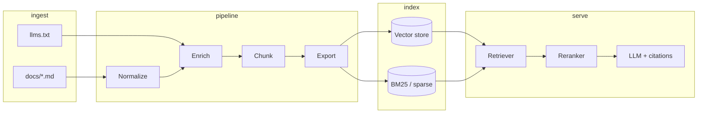
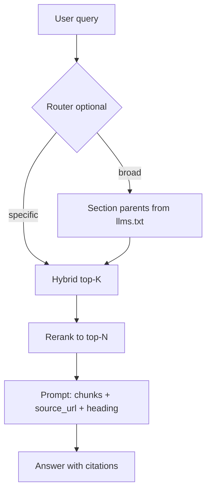

# Hermes docs — post-scrape RAG pipeline architecture

This document describes the pipeline that turns Crawl4AI output in `docs/` into a retrieval-ready corpus. It assumes upstream scraping is handled by `scrape_llms.py` and `llms.txt`.

## Implementation status

- Stages 1–4 and retrieval/eval are implemented in `pipeline/` (**reference implementation only** — the production path is the Qdrant plugin below).
- The Hermes integration lives in `hermes-docs-qdrant/`: a standalone plugin that ingests `corpus/chunks.jsonl` into Qdrant and exposes `docs_search` / `docs_read` / `docs_outline` to the agent. See its `README.md`.

## Quick start

```powershell
Set-Location pipeline
python run_pipeline.py --eval          # normalize -> enrich -> chunk -> index -> eval
python run_pipeline.py --from chunk    # resume after a stage
python retrieve.py "configure OpenAI endpoint"
python retrieve.py --json --doc-type reference "environment variables"
```

| Stage | Script | Input → Output |
|-------|--------|----------------|
| 1 Normalize | `pipeline/normalize.py` | `docs/` → `clean/` (+ `corpus/normalize_report.json`) |
| 2 Enrich | `pipeline/enrich.py` | `clean/` + `llms.txt` → `corpus/documents.jsonl` |
| 3 Chunk | `pipeline/chunk.py` | `corpus/documents.jsonl` → `corpus/chunks.jsonl`, `corpus/parents.jsonl` |
| 4 Index | `pipeline/index.py` | `chunks.jsonl` → `corpus/index/{dense.faiss,bm25.pkl,manifest.json}` |
| 5 Retrieve | `pipeline/retrieve.py` | query → ranked chunks with citations |
| 6 Eval | `pipeline/eval_retrieval.py` | `eval/queries.jsonl` → `eval/last_run.json` |

Measured on this corpus: 249 docs → 6.29M clean chars (31.9% chrome removed) → 4,583 chunks (median 244 tokens, hard max 1,000) → 2,560-dim index (`openrouter:qwen/qwen3-embedding-4b`). Full rebuild including remote embedding: ~6 min.

### Embedding provider

`pipeline/embedder.py` resolves a provider profile from `pipeline/config.yaml`:

| Profile | Model | Endpoint | Notes |
|---------|-------|----------|-------|
| `openrouter` (active) | `qwen/qwen3-embedding-4b` | `https://openrouter.ai/api/v1` | needs `OPENROUTER_API_KEY` |
| `deepinfra` | `Qwen/Qwen3-Embedding-4B` | `https://api.deepinfra.com/v1/openai` | needs `DEEPINFRA_API_KEY` |
| `local` | `Qwen/Qwen3-Embedding-4B` | sentence-transformers | ~8 GB VRAM |
| `openai_compat` | any | configurable | needs `EMBED_API_KEY` |

Keys load from `.env` at the repo root (see `.env.example`) or the environment; `EMBED_PROVIDER` overrides the profile per run. Query strings get the Qwen3 instruction prefix, documents never do. `retrieve.py` refuses to query an index whose `embed_signature` differs from the active profile — re-run `index.py` after switching.

## Goals

- Maximize recall and precision for Hermes-specific questions (CLI, config, gateways, plugins).
- Minimize duplicated Docusaurus chrome in embeddings.
- Preserve citeable URLs and section headings in every retrieved unit.
- Support incremental refresh when docs change.

## System context



## Stage 0 — Inputs

| Artifact | Role |
|----------|------|
| `llms.txt` | Canonical map: section, title, one-line description, URL |
| `docs/**/*.md` | Raw pages with YAML front matter (`title`, `source`, `scraped_at`) |
| `scrape_manifest.json` | Batch stats; future hook for failed-URL retry |

Optional upgrade path: clone `NousResearch/hermes-agent` → `website/docs/**/*.mdx` for static catalogs and cleaner prose (replaces crawl for text-heavy pages).

## Stage 1 — Normalize (`normalize.py`)

**Purpose:** One clean markdown body per logical page.

Operations:

1. Parse YAML front matter; fail closed if `success: false`.
2. Strip recurring Docusaurus noise (regex + heuristics):
   - Skip link line, logo header, language switcher
   - Sidebar bullet blocks (detect repeated `*` nav trees)
   - Footer blocks (“Docs / Community / More”, MIT license)
   - “On this page” duplicate TOCs when they repeat H2 anchors
3. Normalize links: resolve same-site URLs to paths; keep absolute `source` for citations.
4. Remove empty lines runs; fix heading hierarchy if a stray `#` appears after strip.
5. Emit `clean/<mirrored-path>.md` and `normalize_report.json` (bytes removed, warnings).

**Re-scrape alternative (preferred long-term):** Crawl4AI with `css_selector` on `article` / `.theme-doc-markdown` and `fit_markdown` instead of `raw_markdown`—merge into scraper so normalize does less.

## Stage 2 — Enrich (`enrich.py`)

**Purpose:** Attach retrieval metadata not present in raw HTML.

Per document record:

| Field | Source |
|-------|--------|
| `doc_id` | Stable slug from path |
| `title` | Front matter |
| `source_url` | Front matter `source` |
| `section` | Nearest `##` heading in `llms.txt` for this URL |
| `summary` | `llms.txt` description line after the link |
| `breadcrumb` | Path segments (`user-guide` → `features` → `cron`) |
| `doc_type` | Rule from path: `reference`, `guide`, `feature`, `messaging`, `developer`, `getting-started` |
| `content_hash` | SHA-256 of clean body |
| `lang` | `en` (exclude `zh-Hans` unless multilingual RAG is enabled) |

**Dynamic catalogs:** Pages with “Loading …” stubs (e.g. automation blueprints catalog) get a `supplement` flag. A sidecar job fetches MDX from GitHub or a JSON API and writes `supplements/<doc_id>.md` merged at chunk time.

## Stage 3 — Chunk (`chunk.py`)

**Purpose:** Split on structure, not arbitrary token windows.

Strategy by `doc_type`:

| `doc_type` | Split | Target size | Notes |
|------------|-------|-------------|-------|
| `reference` | `##` / `###` | 300–600 tokens | Keep tables/code blocks atomic |
| `guide` | `##` | 500–900 tokens | Allow slight overlap inside same H2 only |
| `feature` | `##` | 400–700 tokens | Inject doc summary prefix |
| `getting-started` | `##` | 500–800 tokens | Preserve ordered steps |

Each chunk record:

```json
{
  "chunk_id": "user-guide/features/cron#scheduled-tasks",
  "doc_id": "user-guide/features/cron",
  "title": "Scheduled Tasks (Cron)",
  "heading": "Scheduled Tasks",
  "text": "...",
  "source_url": "https://hermes-agent.nousresearch.com/docs/...",
  "breadcrumb": ["Features", "Automation", "Cron"],
  "doc_summary": "from llms.txt",
  "section": "Using Hermes",
  "doc_type": "feature",
  "token_count": 412,
  "content_hash": "..."
}
```

**Parent chunks:** One extra chunk per doc—the `llms.txt` summary + title only—for routing and “overview” retrieval.

Output: `corpus/chunks.jsonl`.

## Stage 4 — Index (`index.py`)

**Purpose:** Dual sparse + dense indexes with shared chunk IDs.

1. **Dense:** Embed `doc_summary + "\n\n" + heading + "\n\n" + text` (summary prefix improves conceptual match).
2. **Sparse:** BM25 over `text` + `title` + `heading` (helps symbols: `/blueprint`, `config.yaml`, env vars).
3. **Metadata filters:** `doc_type`, `section`, `breadcrumb` prefix—exposed at query time.
4. **Dedup:** Drop chunks with identical `content_hash` after normalize (should be rare post-strip).

Store: user’s choice (Chroma, LanceDB, pgvector + tsvector, etc.). Keep `corpus/index_manifest.json` with embedding model id, dimension, and chunk count.

## Stage 5 — Query / serve (`retrieve.py`)

Default retrieval graph:



1. **Optional router:** Embed query against parent doc chunks; pick 1–3 sections.
2. **Hybrid:** `score = α * dense + (1-α) * sparse` (start α ≈ 0.65).
3. **Rerank:** Cross-encoder or lightweight LLM on top 20 → final 6–8.
4. **Prompt contract:** Each block includes `source_url` and `heading`; model must cite them.

## Stage 6 — Refresh & ops

| Trigger | Action |
|---------|--------|
| Weekly / manual | `scrape_llms.py` → diff `content_hash` |
| Changed docs only | Re-normalize, re-chunk, re-embed affected `doc_id`s |
| New URLs in `llms.txt` | Full path for new `doc_id` only |
| Scrape failures | `scrape_manifest.json` errors → retry queue |

Version everything: `pipeline_version` in `index_manifest.json`; keep old chunk JSONL for rollback.

## Suggested repo layout (to add)

```
hermes/
├── scrape_llms.py          # existing
├── llms.txt
├── docs/                   # raw scrape
├── pipeline/
│   ├── normalize.py
│   ├── enrich.py
│   ├── chunk.py
│   ├── index.py
│   ├── retrieve.py
│   └── config.yaml         # selectors, chunk rules, embed model
├── clean/                  # normalized md
├── corpus/
│   ├── chunks.jsonl
│   └── parents.jsonl
└── POST_SCRAPE_PIPELINE.md # this file
```

## Implementation order

1. **Normalize** — biggest quality lift; validate on 5 pages including `reference/automation-blueprints-catalog.md`.
2. **Enrich + chunk** — emit `chunks.jsonl`; manual spot-check chunk boundaries on CLI reference.
3. **Index + hybrid retrieve** — scriptable eval set (20 questions).
4. **Re-scrape tuning** — CSS selector + `fit_markdown` in `scrape_llms.py`.
5. **Supplements** — GitHub MDX / API for dynamic catalogs.

## Evaluation (minimal)

Maintain `eval/queries.jsonl`: `{ "query", "expected_doc_ids", "notes" }`. Track:

- Recall@10 on `expected_doc_ids`
- Citation accuracy (URL in answer matches retrieved chunk)
- Noise rate (retrieved chunk contains nav footer keywords)

## Non-goals (v1)

- Multilingual (`zh-Hans`) indexing
- Real-time sync with production docs site
- Training custom embeddings
